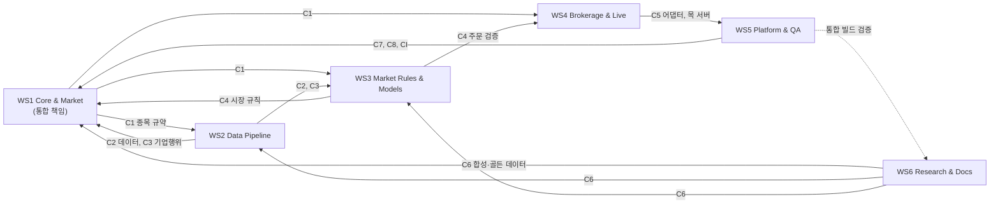
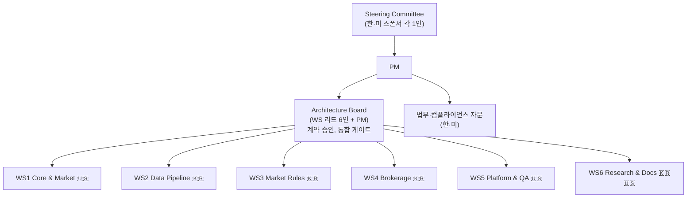
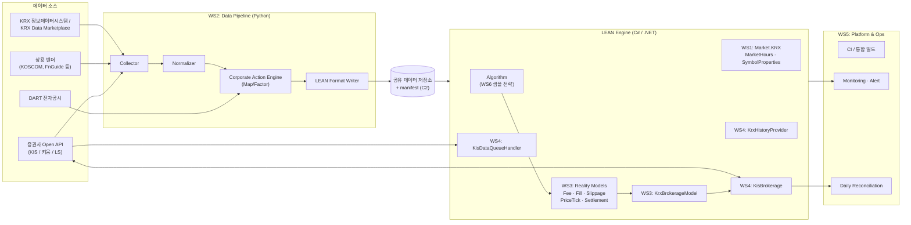
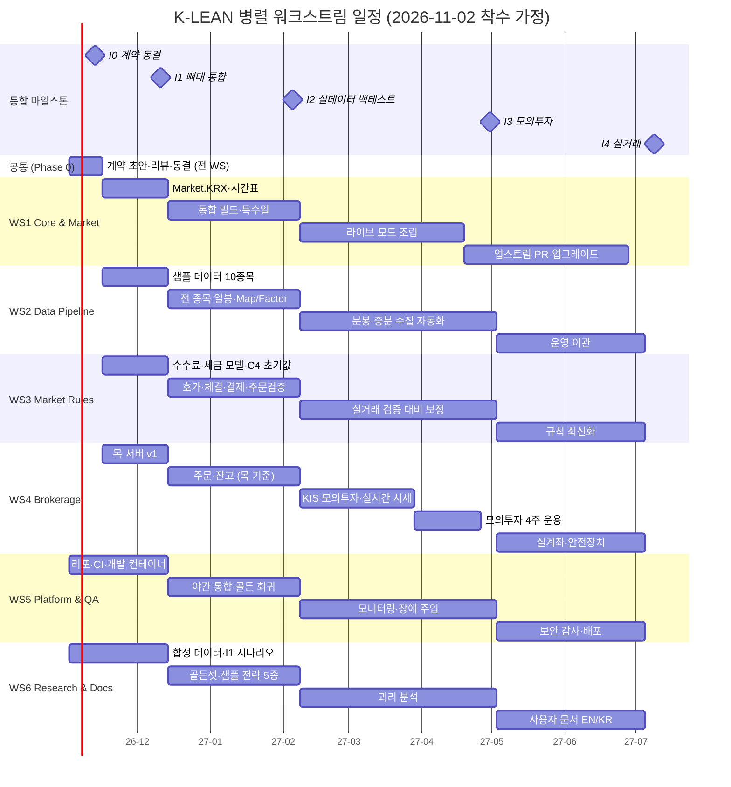

# 프로젝트 기획안: QuantConnect × KRX 연동 (Project "K-LEAN")

> **한미 공동 프로젝트: 5~6개 팀(또는 개인)이 워크스트림을 나눠 동시에 개발하고, 정해진 통합 시점에 하나로 합치는 방식으로 QuantConnect LEAN 엔진에 한국거래소(KRX) 지원을 추가합니다.**

| 항목 | 내용 |
|---|---|
| 문서 버전 | v1.0 (병렬 워크스트림 구조로 개편) |
| 작성일 | 2026-10-09 |
| 작성자 | PM (Claude) |
| 상태 | Draft: 스폰서 승인 대기 |
| 대상 독자 | 프로젝트 스폰서, 워크스트림 리드, 법무·컴플라이언스, 참여 개인 기여자 |
| 코드네임 | **K-LEAN** (Korea + LEAN) |

> ⚠️ 표기 규칙: **[확인 필요]**가 붙은 항목은 규정·요율·API 사양처럼 자주 바뀌는 사실이므로, 착수 전에 공식 출처(KRX, 금융위원회/금감원, 증권사 API 문서, QuantConnect 문서)에서 다시 확인해야 합니다.

### v0.9 → v1.0 변경 요약

| 변경 | 내용 |
|---|---|
| 조직 구조 | 기능별 한·미 분업 → **6개 독립 워크스트림(WS1~WS6)**. 각 워크스트림은 1~3명의 팀이나 개인이 맡을 수 있게 설계 |
| 신규 4장 | 병렬 개발 원칙과 워크스트림 정의 (미션, 산출물, 완료 기준) |
| 신규 5장 | **인터페이스 계약(Contract)**: 워크스트림끼리 기다리지 않고 동시에 작업하기 위한 사전 합의물 |
| 신규 6장 | 리포지토리, 브랜치, 공유 데이터 저장소 구조 |
| 신규 7장 | **통합(규합) 계획**: 통합 마일스톤 I0~I4와 각 시점의 합류 조건 |
| 일정, 예산, 리스크, QA | 워크스트림 기준으로 재작성하고 통합 리스크를 추가 |

---

## 목차

1. [요약](#1-요약)
2. [배경 및 문제 정의](#2-배경-및-문제-정의)
3. [목표, 비목표, 성공 지표](#3-목표-비목표-성공-지표)
4. [병렬 개발 원칙과 워크스트림 구조](#4-병렬-개발-원칙과-워크스트림-구조)
5. [인터페이스 계약 (Contracts)](#5-인터페이스-계약-contracts)
6. [리포지토리, 브랜치, 공유 저장소](#6-리포지토리-브랜치-공유-저장소)
7. [통합(규합) 계획](#7-통합규합-계획)
8. [조직 및 한미 협업 모델](#8-조직-및-한미-협업-모델)
9. [한국 시장 특성과 요구사항](#9-한국-시장-특성과-요구사항)
10. [시스템 아키텍처](#10-시스템-아키텍처)
11. [컴포넌트 상세 설계](#11-컴포넌트-상세-설계)
12. [데이터 소싱 전략](#12-데이터-소싱-전략)
13. [브로커리지(주문 집행) 연동 전략](#13-브로커리지주문-집행-연동-전략)
14. [법무, 규제, 컴플라이언스](#14-법무-규제-컴플라이언스)
15. [일정](#15-일정)
16. [예산 및 리소스](#16-예산-및-리소스)
17. [리스크 관리](#17-리스크-관리)
18. [품질 보증 및 테스트 전략](#18-품질-보증-및-테스트-전략)
19. [오픈소스 및 거버넌스](#19-오픈소스-및-거버넌스)
20. [의사결정 필요 사항](#20-의사결정-필요-사항)
21. [부록](#21-부록)

---

## 1. 요약

**무엇을:** QuantConnect의 오픈소스 엔진 **LEAN**에 한국 주식시장(KOSPI, KOSDAQ, 이후 Nextrade(NXT) 대체거래소)을 정식 시장으로 추가합니다. 범위는 히스토리 데이터, 현실적인 백테스트 모델, 모의투자, 실거래 연동까지입니다.

**어떻게 나눠서:** 전체 작업을 서로 결합도가 낮은 **6개 워크스트림**으로 나눕니다.

| WS | 이름 | 한 줄 미션 |
|---|---|---|
| **WS1** | Core & Market Definition | LEAN에 `Market.KRX`, 종목 체계, 거래시간·휴장일을 정의하고 전체 조립(통합 빌드)을 책임 |
| **WS2** | Data Pipeline | KRX 데이터를 수집해 LEAN 포맷으로 변환하고 기업행위 보정 파일을 생성 |
| **WS3** | Market Rules & Reality Models | 수수료·세금, 호가단위, 체결, 결제(T+2), 주문 검증 규칙을 모델로 구현 |
| **WS4** | Brokerage & Live Data | 증권사 Open API(1차: 한국투자증권 KIS)를 LEAN 브로커리지와 실시간 데이터로 연결 |
| **WS5** | Platform, DevOps & QA | CI/CD, Docker, 통합 테스트 하네스, 모니터링, 리컨실리에이션 |
| **WS6** | Research, Validation & Docs | 샘플 전략, 골든 데이터셋, 정확도 검증, 사용자 문서, 법무 창구 |

**어떻게 합치나:** 착수 2주 차에 **인터페이스 계약(C1~C8)**을 동결합니다. 이후 각 워크스트림은 다른 팀의 실제 결과물 대신 **목(mock)과 합성 데이터**로 독립 개발합니다. 통합은 마지막에 한꺼번에 하지 않고, **5번의 통합 마일스톤(I0~I4)**마다 실제 결과물로 교체해 가며 점진적으로 합칩니다. 첫 번째 실질 통합(I1, 6주 차)은 "삼성전자 일봉 백테스트가 엔진 끝까지 도는 뼈대(walking skeleton)"입니다.

**기간:** 약 9개월. 5개 팀만 모이면 WS5와 WS6을 합칩니다(4.4절).

---

## 2. 배경 및 문제 정의

### 2.1 현황

| 구분 | 현재 상태 | 문제점 |
|---|---|---|
| 백테스트 | pykrx, FinanceDataReader 등으로 수집한 데이터에 자체 스크립트, backtrader나 zipline 포크 사용 | 생존편향, 기업행위 보정 누락, 비현실적 체결 가정 |
| 실거래 | 증권사별 API(키움 OpenAPI+는 Windows/COM/32bit 제약)로 별도 코드 작성 | 백테스트 코드와 실거래 코드가 이원화됨 |
| QuantConnect | 미국 중심. 커스텀 데이터(`PythonData`)로 KRX 데이터를 넣을 수는 있으나 비공식 방식 | 호가단위, 세금, 거래시간, 결제주기, 실거래 연동이 없음 |

### 2.2 기회

- **LEAN은 Apache 2.0 오픈소스**이고 `IBrokerage`, `IDataQueueHandler`, `IHistoryProvider`, `IFeeModel` 같은 플러그인 인터페이스가 잘 나뉘어 있습니다. 이 구조 덕분에 워크스트림을 인터페이스 단위로 쪼개 병렬 개발하기 좋습니다.
- 한국 증권사의 **REST/WebSocket 기반 Open API**(KIS Developers, 키움 REST API, LS증권 Open API 등)가 보편화되어 Linux와 Docker에서 연동할 수 있습니다.
- 공매도 재개, 대체거래소 출범 등 시장 구조 변화로 정교한 시뮬레이터에 대한 수요가 늘었습니다. **[확인 필요: 최신 제도 현황]**

### 2.3 문제 정의

> "한국 주식을 대상으로 하는 퀀트 전략을 **하나의 코드베이스**로 연구, 백테스트, 모의투자, 실거래까지 일관되게 운용할 수 있는 **검증된 오픈 인프라가 없다**."

---

## 3. 목표, 비목표, 성공 지표

### 3.1 목표

| ID | 목표 | 주 담당 WS |
|---|---|---|
| G1 | `Market.KRX`(가칭)를 LEAN에 추가하고 market-hours, symbol-properties DB에 등록 | WS1 |
| G2 | 2000년 이후 KOSPI/KOSDAQ 전 종목 일봉, 최근 N년 분봉, 상장폐지 종목 포함 데이터 | WS2 |
| G3 | 호가단위, 상하한가, 단일가매매, 거래세, 수수료, 슬리피지를 반영한 체결 시뮬레이션 | WS3 |
| G4 | 최소 1개 국내 증권사 API로 주문, 체결, 잔고, 실시간 시세 | WS4 |
| G5 | 같은 알고리즘 코드를 백테스트, 모의투자, 실거래에서 수정 없이 실행 | WS1 + WS5 (통합) |
| G6 | 분산된 팀이 계약 기반으로 병렬 개발하고 정기적으로 통합하는 프로세스 정착 | PM + WS1 |

### 3.2 비목표 (이번 범위에서 제외)

- 파생상품(KOSPI200 선물·옵션, ELW) 실거래 (Phase 4 후보)
- 초단타(HFT) 수준의 지연시간 최적화
- 타인 자금 운용 서비스(투자일임, 자문). 별도 인허가 사안입니다.
- QuantConnect 클라우드에 KRX 데이터를 상업 배포하는 것. QC 본사와의 별도 파트너십 사안입니다.

### 3.3 성공 지표 (KPI)

| KPI | 목표치 | 측정 방법 | 책임 WS |
|---|---|---|---|
| 데이터 정확도 | 일봉 종가 일치율 ≥ 99.99% (KRX 공식 대비) | 샘플 1,000종목 × 전 기간 자동 대사 | WS2 (검증 WS6) |
| 기업행위 보정 정확도 | 수정주가 오차 < 0.01% | 상위 200종목을 외부 벤더와 교차검증 | WS2 (검증 WS6) |
| 백테스트 vs 실거래 괴리 | 모의투자 4주 운용 시 일별 P&L 괴리 < 10bp | 동일 전략 병행 운용 | WS3, WS4 (검증 WS6) |
| 주문 처리 안정성 | 실거래 주문 성공률 ≥ 99.9%, 재연결 후 상태 복구 100% | 장애 주입 테스트 | WS4 (검증 WS5) |
| 지연시간 | 시그널 발생부터 주문 접수까지 p95 < 300ms (REST 기준) | 로그 타임스탬프 | WS4 |
| 테스트 커버리지 | 신규 코드 ≥ 80% | CI 리포트 | 전 WS |
| **통합 건전성** | 통합 마일스톤 지연 ≤ 1주, main 브랜치 빌드 성공률 ≥ 95% | CI 이력 | WS1, WS5 |
| **계약 안정성** | 동결 이후 계약의 하위호환 불가 변경 ≤ 2회 | 계약 변경 로그 | PM |

---

## 4. 병렬 개발 원칙과 워크스트림 구조

### 4.1 다섯 가지 원칙

1. **계약 먼저 (Contract-first)**: 코드를 쓰기 전에 워크스트림 사이의 경계(데이터 포맷, C# 인터페이스, 설정 파일 스키마)를 문서와 코드 스텁으로 합의하고 동결합니다(5장).
2. **목 먼저 (Mock-first)**: 다른 워크스트림의 결과물이 아직 없으면 기다리지 않습니다. 계약에 맞춘 목, 합성 데이터, 가짜 증권사 서버로 개발하고, 통합 마일스톤에서 실물로 교체합니다.
3. **자기 디렉터리만 소유 (Own your directory)**: 각 워크스트림은 리포지토리 안에서 자기 디렉터리만 수정합니다. 다른 디렉터리를 바꿔야 하면 해당 소유 WS에 PR을 보냅니다(`CODEOWNERS`로 강제).
4. **작게 자주 합치기 (Integrate continuously)**: 장기 브랜치를 금지합니다. 기능 플래그 뒤에 숨긴 채로 최소 주 1회 main에 병합하고, main은 항상 빌드와 테스트가 통과해야 합니다.
5. **통합은 시연으로 증명 (Demo-driven integration)**: 통합 마일스톤마다 정해진 시나리오가 실제로 끝까지 도는 것을 보여야 통과입니다. "각 모듈은 다 됐다"는 통합 완료가 아닙니다.

### 4.2 워크스트림 개요

| WS | 권장 담당 | 인원 | 제공하는 것 (Outputs) | 필요로 하는 것 (Inputs) | 기다리는 동안 쓸 대체물 |
|---|---|---|---|---|---|
| **WS1** Core & Market | 🇺🇸 C#/.NET, LEAN 경험자 | 2 | C1 종목·시장 규약, LEAN 확장 코드, 통합 빌드 | C2 데이터, C4 시장 규칙 | WS6의 합성 데이터, 기본값 규칙 YAML |
| **WS2** Data Pipeline | 🇰🇷 데이터 엔지니어 | 1~2 | C2 데이터 포맷, C3 기업행위 스키마, 실데이터 | C1 종목 규약 | (외부 원천만 사용, 의존 적음) |
| **WS3** Market Rules & Models | 🇰🇷 퀀트 + C# 개발자 | 1~2 | C4 시장 규칙 테이블, 수수료·체결·호가·결제 모델 | C1, C2 | 합성 데이터, 단위 테스트 픽스처 |
| **WS4** Brokerage & Live | 🇰🇷 증권사 API 경험자 | 2 | C5 브로커 어댑터, KIS 브로커리지 플러그인, 실시간 데이터 | C1, C4 (주문 검증) | 자체 목 서버(KIS 모사), 기본 주문 검증 |
| **WS5** Platform & QA | 🇺🇸 DevOps / QA | 1~2 | C7 로그·메트릭, C8 설정·비밀정보 규약, CI, Docker, 테스트 하네스 | 전 WS의 빌드 산출물 | 빈 스텁 프로젝트로 파이프라인 선구축 |
| **WS6** Research & Docs | 🇰🇷/🇺🇸 퀀트 리서처, 테크니컬 라이터 | 1~2 | C6 골든 데이터셋·합성 데이터, 샘플 전략, 검증 리포트, 문서 | 통합 빌드 | 공개 데이터(pykrx 등) 기반 기준값 |

> 권장 담당 위치는 강점 기준의 제안입니다. 실제 배정은 참여자 역량에 맞춰 Phase 0에서 확정합니다.

### 4.3 워크스트림 상세 카드

각 카드는 담당 팀에 그대로 넘겨 착수 문서로 쓸 수 있게 작성했습니다.

#### WS1. Core & Market Definition (통합 책임 WS)

| 항목 | 내용 |
|---|---|
| 미션 | LEAN이 "한국 시장"을 이해하게 만들고, 모든 워크스트림의 결과물이 하나로 조립되는 통합 빌드를 책임집니다. |
| 범위 | `Market.KRX` 등록, Symbol 체계(6자리 코드, ISIN, `SecurityIdentifier`), `market-hours-database`(세션, 휴장일, 지연개장), `symbol-properties-database`, 벤치마크 지수, LEAN 버전 고정과 업그레이드, 업스트림 PR |
| 범위 밖 | 데이터 수집(WS2), 수수료·체결 로직(WS3), 증권사 연동(WS4) |
| 산출물 | C1 계약 문서와 C# 상수, LEAN 확장 패키지, 통합 빌드(`integration` 구성), 통합 마일스톤 시연 |
| 완료 기준 | 샘플 알고리즘이 `add_equity("005930", market=Market.KRX)`로 백테스트를 끝까지 실행. 연초 지연개장 등 특수일이 시간표에 반영됨 |
| 1인 운영 시 우선순위 | ① C1 동결 → ② market-hours/symbol-properties → ③ 통합 빌드 → ④ 업스트림 PR |

#### WS2. Data Pipeline

| 항목 | 내용 |
|---|---|
| 미션 | 신뢰할 수 있는 KRX 히스토리 데이터를 LEAN이 바로 읽는 형태로 만듭니다. |
| 범위 | 수집기(일봉, 분봉, 상장·폐지 이력), 정규화(KST, 정합성 검사), LEAN 포맷 변환기, Map File(코드 변경, 합병), Factor File(분할, 무상증자, 배당, 유상증자 권리락), 유니버스용 기초 데이터(시총, 업종, 관리종목 플래그), 데이터 매니페스트 발행 |
| 범위 밖 | 데이터 라이선스 계약 체결(PM/법무), 정확도 최종 판정(WS6) |
| 산출물 | C2·C3 계약, 변환기 코드(Python), 공유 저장소에 버전별 데이터 묶음과 매니페스트 |
| 완료 기준 | 골든 데이터셋(C6) 대비 회귀 테스트 불일치 0건, KPI 정확도 충족 |
| 1인 운영 시 우선순위 | ① 일봉 + 변환기 → ② Factor/Map → ③ 분봉 → ④ 기초 데이터 |

#### WS3. Market Rules & Reality Models

| 항목 | 내용 |
|---|---|
| 미션 | 백테스트 체결이 실제 한국 시장과 최대한 같게 동작하도록 시장 규칙을 모델로 옮깁니다. |
| 범위 | C4 시장 규칙 테이블(연도별 거래세율, 호가단위 체계, 상하한가, 세션 유형), `KrxFeeModel`, `KrxPriceVariationModel`, `KrxFillModel`(상하한가, 단일가, VI), `KrxSlippageModel`, `KrxSettlementModel`(T+2), `KrxBrokerageModel`(주문유형 검증, 공매도 규정) |
| 범위 밖 | 증권사별 주문 코드 매핑(WS4) |
| 산출물 | C4 YAML 테이블과 로더, 모델 패키지, 규칙별 근거 문서(출처와 적용 기간) |
| 완료 기준 | 규칙별 단위 테스트 통과, 특수 사례(상한가, VI, 서킷브레이커) 리플레이 테스트 통과 |
| 1인 운영 시 우선순위 | ① 수수료·세금 → ② 호가단위 → ③ 결제 → ④ 체결 모델 → ⑤ 슬리피지 |

> 핵심 원칙: **규칙은 코드에 하드코딩하지 않고 C4 테이블에 둡니다.** 세율이나 거래시간이 바뀌어도 테이블만 고치면 되고, 다른 WS와 충돌하지 않습니다.

#### WS4. Brokerage & Live Data

| 항목 | 내용 |
|---|---|
| 미션 | 같은 알고리즘을 모의투자와 실계좌에서 그대로 돌릴 수 있게 증권사 API를 LEAN에 연결합니다. |
| 범위 | C5 브로커 어댑터 인터페이스, KIS 목 서버, `KisBrokerage`(`IBrokerage`), `KisDataQueueHandler`(`IDataQueueHandler`), 히스토리 프로바이더, 토큰 관리, Rate Limiter, 재연결과 상태 재동기화, 실거래 안전장치(Kill switch 등) |
| 범위 밖 | 체결 시뮬레이션(WS3), 운영 모니터링 인프라(WS5) |
| 산출물 | 브로커리지 플러그인, KIS 목 서버(다른 WS도 사용), 주문유형 매핑표 |
| 완료 기준 | QC 브로커리지 표준 테스트 통과, 모의투자 4주 무중단 운용 |
| 1인 운영 시 우선순위 | ① 목 서버 + 어댑터 → ② 주문·잔고 → ③ 실시간 시세 → ④ 히스토리 → ⑤ 장애 복구 |

#### WS5. Platform, DevOps & QA

| 항목 | 내용 |
|---|---|
| 미션 | 모든 팀이 같은 환경에서 빌드하고 테스트하고 배포하게 만들고, 통합을 자동으로 검증합니다. |
| 범위 | 모노레포 CI(GitHub Actions), WS별 빌드·테스트 잡, 야간 통합 빌드, LEAN CLI 기반 Docker 이미지, 계약 테스트 자동 실행, 장애 주입 테스트 환경, 모니터링(Prometheus/Grafana), 알림, 일일 잔고 대사 도구 |
| 범위 밖 | 각 WS 기능의 단위 테스트 작성(각 WS 책임) |
| 산출물 | C7·C8 계약, CI 파이프라인, 개발용 컨테이너, 통합 테스트 하네스, 운영 대시보드 |
| 완료 기준 | 신규 참여자가 문서만 보고 1시간 안에 로컬 빌드·테스트 성공. 야간 통합 빌드 결과가 매일 자동 공유됨 |
| 1인 운영 시 우선순위 | ① 리포 골격 + CI → ② 개발 컨테이너 → ③ 계약 테스트 → ④ 통합 하네스 → ⑤ 모니터링 |

#### WS6. Research, Validation & Docs

| 항목 | 내용 |
|---|---|
| 미션 | "제대로 동작하는가"를 독립적으로 판정하고, 사용자가 쓸 수 있게 문서화합니다. |
| 범위 | C6 골든 데이터셋과 합성 데이터 생성기(다른 WS의 목 데이터로 사용), 샘플 전략 5종, 정확도 검증 리포트, 백테스트 vs 모의투자 괴리 분석, 사용자 가이드(EN/KR), 용어집 관리, 법무 검토 창구 |
| 범위 밖 | 버그 수정 자체(해당 WS 책임, WS6은 재현 케이스 제공) |
| 산출물 | C6 픽스처, 샘플 전략, 마일스톤별 검증 리포트, 문서 사이트 |
| 완료 기준 | 각 통합 마일스톤에 검증 리포트 제출, 사용자 문서로 외부인이 샘플 전략 실행 가능 |
| 1인 운영 시 우선순위 | ① 합성 데이터 + 골든셋(I1 전 필수) → ② 샘플 전략 → ③ 검증 리포트 → ④ 문서 |

### 4.4 인원 구성별 운영안

| 구성 | 조정 방법 |
|---|---|
| **6팀** | 위 구조 그대로 |
| **5팀** | **WS5와 WS6을 합칩니다** ("Platform & Validation"). 둘 다 다른 WS의 결과물을 검증하는 성격이라 합치기 쉽습니다. 문서화는 각 WS가 자기 영역을 쓰고 이 팀이 편집만 합니다. |
| **4팀 이하** | WS3을 WS1과 WS2로 나눠 흡수합니다(규칙 테이블은 WS2, 모델 코드는 WS1). 일정은 약 30% 늘어납니다. |
| **개인 기여자 위주** | 각 WS를 1인이 맡고, 위 카드의 "1인 운영 시 우선순위" 순서대로 진행합니다. WS1 담당자는 통합 책임 때문에 반드시 경험자가 맡아야 합니다. |

---

## 5. 인터페이스 계약 (Contracts)

병렬 개발이 성립하는지는 이 장에 달려 있습니다. 계약은 **0~2주 차(Phase 0)에 초안을 쓰고 2주 차 말(I0)에 동결**합니다. 동결 후에는 각 WS가 계약만 보고 일합니다.

### 5.1 계약 목록

| ID | 계약 | 소유 WS | 사용 WS | 형태 | 동결 |
|---|---|---|---|---|---|
| **C1** | 종목·시장 규약 (Market 이름, 티커 표기, ISIN 매핑, 거래소 구분, 시간대) | WS1 | 전체 | Markdown 명세 + C# 상수 클래스 | I0 |
| **C2** | 데이터 포맷 (LEAN 디렉터리 구조, 컬럼, 가격 스케일, 타임스탬프 기준) + 데이터 매니페스트 | WS2 | WS1, WS3, WS6 | 명세 + JSON Schema + 샘플 파일 | I0 |
| **C3** | 기업행위 이벤트 스키마 (분할, 무상·유상증자, 배당, 코드 변경, 합병) | WS2 | WS1, WS3, WS6 | JSON Schema | I0 |
| **C4** | 시장 규칙 테이블 (호가단위 체계, 거래세율, 가격제한폭, 세션, 휴장일; 모두 적용 기간 포함) | WS3 | WS1, WS4, WS6 | YAML + JSON Schema + 로더 | I0 (값은 계속 갱신 가능) |
| **C5** | 브로커 어댑터 인터페이스 (인증, 주문, 정정, 취소, 잔고, 체결 스트림, 시세 스트림) | WS4 | WS5, WS6 | C# 인터페이스 + 목 서버 + OpenAPI 명세 | I0 |
| **C6** | 골든 데이터셋과 합성 데이터 (대표 50종목, 특수 이벤트 포함 픽스처) | WS6 | 전체 | 데이터 파일 + 생성 스크립트 | I0 (합성), I2 (골든) |
| **C7** | 로그·메트릭 스키마 (이벤트 이름, 필드, 레벨, 메트릭 이름) | WS5 | 전체 | Markdown + 공용 로거 라이브러리 | I1 |
| **C8** | 설정·비밀정보 규약 (환경변수 이름, 설정 파일 위치, 비밀정보 주입 방식) | WS5 | 전체 | Markdown + `.env.example` | I0 |

### 5.2 계약 예시

**C4 시장 규칙 테이블 (발췌)**

```yaml
# contracts/c4-market-rules/krx.yaml
version: 1.0.0
tick_size:
  - effective_from: 2023-01-25        # [확인 필요]
    markets: [KOSPI, KOSDAQ]
    table:                            # [하한 이상, 상한 미만) : 호가단위(원)
      - [0, 2000, 1]
      - [2000, 5000, 5]
      - [5000, 20000, 10]
      - [20000, 50000, 50]
      - [50000, 200000, 100]
      - [200000, 500000, 500]
      - [500000, null, 1000]
transaction_tax:                      # 매도 시 부과, 농특세 포함 합계
  - { effective_from: 2026-01-01, market: KOSPI,  rate: 0.0020 }   # [확인 필요]
  - { effective_from: 2026-01-01, market: KOSDAQ, rate: 0.0020 }   # [확인 필요]
price_limit:
  - { effective_from: 2015-06-15, pct: 0.30 }
settlement_days: 2
```

**C2 데이터 매니페스트 (발췌)**

```json
{
  "dataset": "krx-equity-daily",
  "version": "2027.02.1",
  "produced_by": "WS2",
  "schema": "c2-lean-equity@1.0",
  "coverage": { "from": "2000-01-04", "to": "2027-02-26", "symbols": 4123, "delisted_included": true },
  "files": [{ "path": "equity/krx/daily/005930.zip", "sha256": "…" }],
  "validation": { "golden_set": "c6-golden@1.1", "mismatches": 0 }
}
```

**C5 브로커 어댑터 인터페이스 (발췌)**

```csharp
// contracts/c5-broker-adapter/IKrxBrokerApi.cs
public interface IKrxBrokerApi
{
    Task<AuthToken> AuthenticateAsync(CancellationToken ct);
    Task<BrokerOrderAck> PlaceOrderAsync(KrxOrderRequest request, CancellationToken ct);
    Task<BrokerOrderAck> ModifyOrderAsync(string brokerOrderId, KrxOrderModify modify, CancellationToken ct);
    Task<BrokerOrderAck> CancelOrderAsync(string brokerOrderId, CancellationToken ct);
    Task<IReadOnlyList<KrxHolding>> GetHoldingsAsync(CancellationToken ct);
    Task<KrxCashBalance> GetCashAsync(CancellationToken ct);          // D+0, D+2 예수금 구분
    IObservable<KrxFillEvent> Fills { get; }
    IObservable<KrxQuote> Quotes { get; }
    Task SubscribeAsync(IEnumerable<string> shortCodes, CancellationToken ct);
}
```

### 5.3 계약 변경 절차

| 변경 유형 | 예 | 절차 |
|---|---|---|
| **패치** (값 수정, 문서 보완) | 2027년 세율 추가, 오타 | 소유 WS가 바로 PR. 사용 WS에 통보만 |
| **마이너** (하위호환 추가) | 선택 필드 추가, 새 이벤트 유형 | 소유 WS가 PR, 사용 WS 리드 1명 이상 승인 |
| **메이저** (하위호환 불가) | 필드 삭제, 의미 변경, 인터페이스 시그니처 변경 | RFC 문서 작성 → 영향받는 **모든 WS 리드 승인** → PM 최종 승인. 다음 통합 마일스톤 이후에만 적용 |

- 계약은 `contracts/` 디렉터리에 두고 **각자 SemVer 버전**을 가집니다. 사용 측은 버전을 명시해 참조합니다.
- **48시간 규칙**: 시차 때문에 승인이 늦어지는 것을 막기 위해, 리뷰 요청 후 48시간 안에 반대 의견이 없으면 PM이 결정합니다.
- 모든 계약에는 **계약 테스트**가 있습니다. 예를 들어 WS2가 낸 데이터가 C2 스키마를 만족하는지 CI가 매번 자동으로 확인합니다(WS5 운영).

---

## 6. 리포지토리, 브랜치, 공유 저장소

### 6.1 모노레포 구조와 소유권

LEAN 코어는 포크하지 않고 버전을 고정해 의존성으로 씁니다. K-LEAN 코드는 하나의 모노레포에 두고 디렉터리별로 소유 WS를 정합니다.

```
k-lean/
├── contracts/                 # 공동 소유. 변경은 5.3 절차를 따름
│   ├── c1-symbol-market/
│   ├── c2-data-format/
│   ├── c3-corporate-actions/
│   ├── c4-market-rules/
│   ├── c5-broker-adapter/
│   ├── c6-fixtures/
│   ├── c7-observability/
│   └── c8-config/
├── src/
│   ├── Core/                  # WS1  Market 정의, Symbol, 통합 조립
│   ├── Models/                # WS3  Fee, Fill, Tick, Settlement, BrokerageModel
│   └── Brokerages.KIS/        # WS4  브로커리지, 데이터큐, 히스토리
├── pipeline/                  # WS2  수집, 변환, Map/Factor (Python)
├── mocks/
│   ├── kis-mock-server/       # WS4  다른 WS도 사용
│   └── synthetic-data/        # WS6  합성 데이터 생성기
├── tests/
│   ├── contract/              # WS5  계약 테스트
│   ├── integration/           # WS5  통합 시나리오 (I1~I4 시연)
│   └── golden/                # WS6  골든 데이터셋 회귀 테스트
├── research/strategies/       # WS6  샘플 전략
├── infra/                     # WS5  Docker, CI, 모니터링
├── docs/                      # WS6 편집, 각 WS가 자기 영역 작성
└── .github/CODEOWNERS         # 디렉터리별 소유 WS 지정
```

### 6.2 브랜치와 병합 규칙

| 규칙 | 내용 |
|---|---|
| 브랜치 이름 | `ws<번호>/<주제>` 예: `ws2/factor-file-rights-issue`, `ws4/order-modify` |
| 수명 | 최대 1주. 그보다 길면 쪼개서 병합 |
| 미완성 기능 | 기능 플래그(`KLEAN_FEATURE_*`) 뒤에 두고 main에 병합 |
| 필수 리뷰 | 자기 디렉터리는 같은 WS 1명. `contracts/` 변경은 5.3 절차. 다른 WS 디렉터리는 해당 소유 WS 승인 |
| main 보호 | CI(빌드, 단위 테스트, 계약 테스트) 통과 필수. 깨지면 원인 WS가 4시간 안에 수정하거나 되돌림 |
| 야간 통합 빌드 | 매일 KST 06:00(미국 저녁)에 전체 통합 시나리오를 실행하고 결과를 공유 채널에 게시 |

### 6.3 공유 데이터 저장소

데이터는 용량이 커서 git에 넣지 않습니다. 공용 저장소를 하나 두고 매니페스트로 버전을 관리합니다.

| 항목 | 내용 |
|---|---|
| 저장소 | 클라우드 버킷(GCS 또는 S3) 또는 공유 Google Drive 폴더. 접근은 `rclone`으로 통일 |
| 구조 | `/<dataset>/<version>/...` + `manifest.json` (C2) |
| 권한 | 쓰기는 생산 WS만(실데이터는 WS2, 픽스처는 WS6). 다른 WS는 읽기 전용 |
| 버전 고정 | 각 WS와 CI는 매니페스트 버전을 명시해서 사용. "최신"을 암묵적으로 쓰지 않음 |
| 라이선스 | 라이선스상 재배포가 안 되는 데이터는 비공개 저장소에만 둠(14장 L1) |
| 접속 정보 | 키와 토큰은 C8 규약의 환경변수로만 주입. 문서나 채팅에 붙여 넣지 않음 |

---

## 7. 통합(규합) 계획

### 7.1 통합 마일스톤

통합은 다섯 번에 나눠 하고, 마일스톤마다 **목을 실물로 하나씩 교체**합니다.

| 마일스톤 | 시점 | 목표 시나리오 (시연) | 목 → 실물 교체 |
|---|---|---|---|
| **I0** 계약 동결 | 2주 차 | 계약 C1~C6, C8 v1.0 동결. 모든 WS가 스텁 프로젝트를 빌드하고 CI 통과 | 없음 (전부 목) |
| **I1** 뼈대 통합 (Walking Skeleton) | 6주 차 | **합성 데이터로 삼성전자(005930) 일봉 매수·매도 전략이 LEAN 백테스트를 끝까지 실행**. 기본 수수료·세금 적용, 결과 리포트 생성 | C1 실물, C4 초기값 실물 / 데이터와 증권사는 목 |
| **I2** 실데이터 백테스트 | 14주 차 | 실데이터 전 종목 일봉 + 일부 분봉으로 샘플 전략 5종 백테스트. 기업행위, 호가단위, 상하한가, T+2 반영 | **C2/C3 실데이터**, WS3 모델 실물 / 증권사는 목 |
| **I3** 모의투자 | 26주 차 | 같은 전략을 KIS 모의투자 계좌로 4주 운용. 백테스트 대비 괴리 리포트 | **WS4 실물(모의투자)**, 모니터링 실물 |
| **I4** 실거래 | 36주 차 | 소액 실계좌 4주 운용, 보안 감사, 문서 공개 | **실계좌** |

### 7.2 마일스톤별 합류 조건 (Entry Criteria)

각 WS는 통합 마일스톤 1주 전까지 아래 조건을 만족해야 합니다. 못 맞추면 해당 부분은 목으로 남겨 두고 통합을 진행하며, 다음 마일스톤으로 넘깁니다. **한 WS의 지연이 전체 통합을 막지 않게** 하는 것이 목적입니다.

| WS | I1 (6주) | I2 (14주) | I3 (26주) | I4 (36주) |
|---|---|---|---|---|
| WS1 | Market.KRX, 시간표, 통합 빌드 | 휴장일·특수일 전 기간 | 라이브 모드 조립 | 업스트림 PR 제출 |
| WS2 | C2 샘플 데이터 10종목 | 전 종목 일봉, Map/Factor, 분봉 일부 | 일일 증분 수집 자동화 | 운영 이관 |
| WS3 | 수수료·세금 모델 | 호가·체결·결제·주문 검증 모델 | 실거래 주문 검증과 일치 확인 | 규칙 테이블 최신화 |
| WS4 | 목 서버 v1 | 주문·잔고 (목 서버 기준) | KIS 모의투자 연동, 실시간 시세 | 실계좌, 안전장치 |
| WS5 | CI, 개발 컨테이너, 계약 테스트 | 야간 통합 빌드, 골든 회귀 | 모니터링, 알림, 장애 주입 | 보안 감사 지원, 배포 |
| WS6 | 합성 데이터, I1 시나리오 | 골든셋 v1, 샘플 전략 5종, 검증 리포트 | 괴리 분석 리포트 | 사용자 문서 EN/KR |

### 7.3 통합 주간 운영

- **통합 책임자**: WS1 리드가 맡고 PM이 지원합니다.
- **통합 주간(마일스톤 마지막 주)**: 신규 기능 병합을 멈추고 버그 수정만 받습니다. 각 WS에서 1명씩 "통합 당번"을 지정합니다.
- **결함 배정**: 통합 중 발견된 결함은 계약 기준으로 책임을 가립니다. 계약을 어긴 쪽이 고치고, 계약 자체가 모호했으면 계약 소유 WS가 계약을 보완합니다.
- **통과 판정**: 시연 시나리오 성공 + WS6 검증 리포트 + CI 통과. PM과 WS 리드 전원이 참여하는 게이트 리뷰에서 결정합니다.

### 7.4 의존 관계도



> 순환 의존(WS1 ↔ WS2 등)은 계약으로 끊습니다. 계약이 동결된 I0 이후에는 어떤 WS도 다른 WS의 **실제 결과물**을 기다리지 않고, 계약과 목만 보고 개발합니다.

---

## 8. 조직 및 한미 협업 모델

### 8.1 조직도



### 8.2 역할

| 역할 | 책임 |
|---|---|
| **PM** | 일정, 범위, 리스크 관리. 계약 분쟁 최종 결정(48시간 규칙). 스폰서 보고 |
| **WS 리드** | 자기 WS의 산출물과 일정. Architecture Board 참여. 계약 소유 시 계약 유지보수 |
| **Architecture Board** | 계약 메이저 변경 승인, 통합 마일스톤 게이트 판정, 기술 결정(ADR) 승인 |
| **통합 책임자 (WS1 리드)** | 통합 빌드 유지, 통합 주간 운영, 결함 배정 |

### 8.3 RACI

| 활동 | PM | WS1 | WS2 | WS3 | WS4 | WS5 | WS6 |
|---|---|---|---|---|---|---|---|
| 계약 초안·동결 | A | R (C1) | R (C2, C3) | R (C4) | R (C5) | R (C7, C8) | R (C6) |
| 통합 빌드 유지 | I | **R/A** | C | C | C | R | C |
| 통합 게이트 판정 | **A** | R | C | C | C | C | R (검증 리포트) |
| 데이터 라이선스 | **A** | I | R | I | I | I | C |
| 시장 규칙 정확성 | I | C | C | **R/A** | C | I | R (검증) |
| 실거래 승인 | **A** | C | I | C | R | R | C |
| 문서 공개 | A | C | C | C | C | C | **R** |

(R=수행, A=최종책임, C=협의, I=통보)

### 8.4 시차 운영 (KST ↔ US)

| 구분 | 한국 시간(KST) | 미 동부(ET, EDT 기준) | 미 서부(PT, PDT 기준) |
|---|---|---|---|
| 겹치는 시간 | 08:00–10:00 | 19:00–21:00 (전일) | 16:00–18:00 (전일) |

> 서머타임 해제 기간(11월~3월)에는 미국 쪽 시간이 1시간씩 앞당겨집니다.

**운영 원칙**

- **WS 내부는 같은 나라 사람끼리** 묶는 것을 기본으로 합니다. 시차 협업은 WS 사이 경계(계약)에서만 일어나도록 해서 실시간 소통 필요를 줄입니다.
- **동기 회의**: 주 1회 Architecture Board(KST 화 08:30, 45분). 그 외는 비동기입니다.
- **비동기 보고**: 각 WS는 매주 금요일 정해진 양식(부록 21.3)으로 진척, 블로커, 계약 변경 요청을 올립니다.
- **Follow-the-sun 리뷰**: 한국 낮에 올린 PR은 미국 저녁에, 미국 낮에 올린 PR은 한국 아침에 리뷰합니다.
- **공식 언어**: 코드, 이슈, PR, 계약 문서는 **영어**. 사용자 문서는 **영어와 한국어 병행**. 용어집(부록 21.1)을 필수로 참조합니다.
- **장중 지원**: 한국 장중(09:00–15:30 KST)은 미국의 심야이므로 실거래 1차 대응은 한국 측 WS4가 맡습니다.
- **도구**: GitHub(Projects, Issues, Discussions), Slack(Shared channel, WS별 채널 + `#integration`), 이중언어 위키, Loom(비동기 데모).

### 8.5 계약 및 IP 구조 (안)

| 옵션 | 내용 | 장점 | 단점 |
|---|---|---|---|
| A. 오픈소스 공동개발 | 결과물을 Apache 2.0으로 공개, 각자 기여분 저작권 유지 | 단순함, 개인 기여자 참여 쉬움 | 상업적 독점 불가 |
| B. 공동소유 + 오픈코어 | 엔진 플러그인은 공개, 데이터 파이프라인과 운영 도구는 비공개 | 수익화 가능 | 계약이 복잡함 |
| C. 한측 소유 + 라이선스 | 한쪽이 IP 소유, 다른 쪽에 라이선스 | 의사결정이 빠름 | 협력 동기 저하 |

**PM 권고: 옵션 B.** 다만 개인 기여자가 많이 참여한다면, 모든 참여자에게 **기여자 라이선스 동의(CLA)**를 착수 전에 받아야 나중에 결과물을 합칠 때 권리 문제가 생기지 않습니다.

---

## 9. 한국 시장 특성과 요구사항

LEAN의 미국 주식 가정과 다른 점들입니다. 이 표는 WS3의 C4 테이블과 WS1의 시간표 작업의 기준선이 됩니다.

| 항목 | 미국 (LEAN 기본) | 한국 KRX | 구현 영향 (담당) |
|---|---|---|---|
| 시간대 | America/New_York | **Asia/Seoul (UTC+9, 서머타임 없음)** | market-hours DB, 데이터 타임스탬프 (WS1, WS2) |
| 정규장 | 09:30–16:00 | **09:00–15:30** | 세션 정의 (WS1) |
| 장전·장후 | Pre/Post market (연속매매) | 장전 시간외 종가(08:30–08:40), **장 개시 단일가(08:30–09:00)**, **장 마감 단일가(15:20–15:30)**, 장후 시간외 종가(15:40–16:00), 시간외 단일가(16:00–18:00) **[확인 필요]** | 세션 유형별 체결 모델 (WS3) |
| 대체거래소 | 다수 ECN | **Nextrade(NXT)**: 2025년 3월 출범, 프리마켓 08:00–08:50, 애프터마켓 15:30–20:00, 일부 종목만 거래 **[확인 필요]** | Phase 4 |
| 가격제한폭 | 없음 (LULD) | **전일 종가 대비 ±30%** | 체결 모델 (WS3) |
| 변동성완화장치 | – | **VI(정적, 동적)**: 발동 시 2분간 단일가 매매 | 체결 모델 (WS3) |
| 서킷브레이커 | 시장 전체 7/13/20% | 지수 8/15/20% 하락 시 단계별 매매정지 | 이벤트 처리 (WS3) |
| 호가단위 | $0.01 고정 | **가격대별 차등** (아래 표) | `PriceVariationModel` (WS3) |
| 최소 주문단위 | 1주 (분수주 가능) | 1주 | lot size = 1 (WS1) |
| 결제 | T+1 | **T+2** | `SettlementModel` (WS3) |
| 통화 | USD | **KRW (소수점 없음)** | 가격 정밀도, 계좌 통화 (WS1) |
| 종목코드 | 티커 (AAPL) | **6자리 단축코드 (005930)** + ISIN (KR7005930003) | C1 (WS1) |
| 거래세 | 없음 | **매도 시 증권거래세(+농특세)**: 2026년 기준 KOSPI 0.20%(거래세 0.05% + 농특세 0.15%), KOSDAQ 0.20% **[확인 필요: 연도별 세율 변동]** | C4 + `FeeModel` (WS3) |
| 공매도 | 자유 (차입 필요) | 2023.11–2025.03 전면 금지 후 재개. 무차입 공매도 금지, 업틱룰 **[확인 필요]** | `BrokerageModel` (WS3) |
| 기업행위 | 분할, 배당 | 분할, **무상증자**, **유상증자(권리락)**, 액면병합, 감자, 합병, 배당 | Factor/Map File (WS2) |
| 휴장일 | NYSE 캘린더 | KRX 캘린더 (설·추석 연휴, 선거일, 연말 휴장, 임시공휴일) | C4 + market-hours (WS1, WS3) |
| 거래정지·관리종목 | – | 관리종목, 투자경고, 투자위험, 거래정지, 정리매매 | 유니버스 필터 (WS2), 체결 불가 (WS3) |

### 9.1 호가단위 테이블 (2023년 1월 개편 기준, KOSPI·KOSDAQ 통일) [확인 필요]

| 주가 구간 (원) | 호가단위 (원) |
|---|---|
| 2,000 미만 | 1 |
| 2,000 이상 – 5,000 미만 | 5 |
| 5,000 이상 – 20,000 미만 | 10 |
| 20,000 이상 – 50,000 미만 | 50 |
| 50,000 이상 – 200,000 미만 | 100 |
| 200,000 이상 – 500,000 미만 | 500 |
| 500,000 이상 | 1,000 |

> 백테스트 정확도를 위해 **과거 호가단위 체계(2023년 이전, KOSPI와 KOSDAQ 상이)**도 기간별로 C4에 넣어야 합니다. ETF·ETN은 별도 단위를 씁니다.

---

## 10. 시스템 아키텍처

### 10.1 전체 구성도 (담당 WS 표시)



### 10.2 아키텍처 원칙

1. **업스트림 친화적**: LEAN 코어는 포크하지 않습니다. 플러그인과 최소한의 업스트림 PR로만 확장합니다.
2. **QuantConnect 브로커리지 템플릿 준수**: `Lean.Brokerages.Template` 구조와 테스트 스위트를 따릅니다.
3. **시간은 내부적으로 UTC, 표시는 KST**.
4. **멱등성과 상태 복구**: 실거래 엔진이 재시작되면 증권사 잔고와 미체결 내역을 기준으로 재동기화합니다.
5. **비밀정보 분리**: API Key, Secret, 계좌번호는 C8 규약에 따라 환경변수나 Vault로만 주입하고 로그에서는 마스킹합니다.
6. **규칙은 데이터로**: 시장 규칙은 C4 테이블에 두고 코드는 테이블을 읽기만 합니다.

### 10.3 주요 아키텍처 결정 (ADR 후보)

| ADR | 질문 | 권고안 | 결정 주체 |
|---|---|---|---|
| ADR-001 | Market 식별자 | `krx` 하나에 KOSPI·KOSDAQ 통합, 거래소 구분은 `PrimaryExchange`로 | WS1 |
| ADR-002 | Symbol 티커 표기 | 6자리 단축코드(`005930`) | WS1 |
| ADR-003 | 브로커리지 구현 언어 | C# (.NET, LEAN 네이티브) | WS4 |
| ADR-004 | 1차 브로커 | 한국투자증권 KIS Developers | Board |
| ADR-005 | 데이터 저장 포맷과 가격 스케일 | LEAN 표준 (zip CSV). KRW 스케일은 I0 전에 결정 | WS2 |
| ADR-006 | NXT 지원 시점 | Phase 4 | Board |
| ADR-007 | 리포 구조 | 모노레포 + CODEOWNERS | Board |
| ADR-008 | 공유 데이터 저장소 | 클라우드 버킷 + rclone (Drive는 소규모 팀 대안) | WS5 |

---

## 11. 컴포넌트 상세 설계

### 11.1 Market 정의 (WS1)

**`market-hours-database.json` 엔트리 (예시)**

```json
"Equity-krx-[*]": {
  "dataTimeZone": "Asia/Seoul",
  "exchangeTimeZone": "Asia/Seoul",
  "sunday": [], "saturday": [],
  "monday": [
    { "start": "08:30:00", "end": "09:00:00", "state": "premarket" },
    { "start": "09:00:00", "end": "15:30:00", "state": "market" },
    { "start": "15:40:00", "end": "18:00:00", "state": "postmarket" }
  ],
  "...": "tuesday ~ friday 동일",
  "holidays": ["1/1/2026", "2/16/2026", "2/17/2026", "2/18/2026", "..."],
  "earlyCloses": {},
  "lateOpens": { "1/2/2026": "10:00:00" }
}
```

> 매년 첫 거래일은 개장이 1시간 늦습니다(10:00). 수능일도 개장과 폐장이 1시간씩 늦춰집니다. **[확인 필요: 연도별 공지]** 휴장일과 특수일의 원본은 C4 테이블에 두고, 이 JSON은 C4에서 자동 생성합니다.

**`symbol-properties-database.csv` 엔트리 (예시)**

```
market,symbol,type,description,quote_currency,contract_multiplier,minimum_price_variation,lot_size
krx,[*],equity,,KRW,1,1,1
```

> `minimum_price_variation`은 고정값만 받으므로, 가격대별 호가단위는 WS3의 커스텀 `IPriceVariationModel`이 처리합니다.

### 11.2 데이터 포맷 및 디렉터리 (WS2, C2)

```
data/
└── equity/
    └── krx/
        ├── daily/005930.zip
        ├── minute/005930/20260105_trade.zip
        ├── map_files/005930.csv
        ├── factor_files/005930.csv
        └── fundamental/coarse/20260105.csv
```

- **가격 스케일**: LEAN 미국 주식은 가격에 10,000을 곱해 정수로 저장합니다. KRW는 이미 정수라 스케일을 1로 할지 10,000으로 할지 ADR-005에서 정합니다.
- **Factor File 산식**: 무상증자 비율 r이면 분할 팩터 = 1/(1+r). 유상증자는 권리락 기준가 산식(KRX 공시)으로 조정 팩터를 계산합니다.

### 11.3 시장 모델 (WS3)

```python
# 개념 코드 (실제 구현은 C#). 세율과 호가는 C4 테이블에서 읽음
class KrxFeeModel(FeeModel):
    def __init__(self, rules: KrxMarketRules, commission_rate: float):
        self.rules = rules                       # C4 로더
        self.commission_rate = commission_rate   # 증권사, 계좌별 설정 (C8)

    def get_order_fee(self, params):
        value = abs(params.order.quantity) * params.security.price
        fee = value * self.commission_rate
        if params.order.direction == OrderDirection.SELL:
            fee += value * self.rules.transaction_tax(params.security.local_time,
                                                      params.security.primary_exchange)
        return OrderFee(CashAmount(int(fee), "KRW"))   # 원 미만 절사 규칙 [확인 필요]
```

| 모델 | 핵심 로직 |
|---|---|
| `KrxFeeModel` | 위탁수수료(설정형) + 매도 거래세(C4), 원 미만 절사 |
| `KrxPriceVariationModel` | C4의 기간별 호가단위 체계 |
| `KrxFillModel` | ① 상한가 매수·하한가 매도는 잔량 큐잉(확률적 체결), ② 시가·종가 단일가 체결가 = 해당 봉 시가·종가, ③ VI 구간 지연 |
| `KrxSlippageModel` | 거래대금 대비 주문 비중에 따른 square-root impact 모델 |
| `KrxSettlementModel` | T+2 매도대금 결제, 예수금(D+2) 관리 |
| `KrxBrokerageModel` | 지원 주문유형 검증, 호가단위 미준수 주문 거부 또는 자동 반올림, 공매도 규정 |

### 11.4 브로커리지 플러그인 (WS4, C5)

| LEAN 인터페이스 | KIS API 매핑 (예시) | 비고 |
|---|---|---|
| `Connect()` | 접근토큰 발급 (OAuth2 client credentials) | 토큰 유효기간과 발급 빈도 제한 **[확인 필요]** |
| `PlaceOrder()` | 국내주식 주문(현금) | 주문유형 코드 매핑 (지정가, 시장가, 조건부, 최유리, 최우선, IOC/FOK) |
| `UpdateOrder()` | 정정 주문 | 원주문번호 관리 |
| `CancelOrder()` | 취소 주문 | |
| `GetOpenOrders()` | 미체결 조회 | 재시작 시 동기화 |
| `GetAccountHoldings()` | 잔고 조회 | |
| `GetCashBalance()` | 예수금, 주문가능금액 | D+2 예수금 구분 |
| `IDataQueueHandler.Subscribe()` | WebSocket 실시간 체결가, 호가 | 세션당 구독 종목 수 제한 대응 **[확인 필요]** |
| 체결 통보 | WebSocket 체결 통보 | 암호화 해독 처리 여부 확인 |
| `IHistoryProvider` | 일봉, 분봉 조회 | 초당 호출 제한 대응 rate limiter |

**KIS 목 서버**: WS4는 C5와 함께 KIS API를 흉내 내는 목 서버를 I1 전에 내놓습니다. 주문 접수, 부분 체결, 거부, 토큰 만료, 연결 끊김 같은 상황을 설정으로 재현할 수 있어서 WS5의 장애 주입 테스트와 WS6의 검증에도 그대로 쓰입니다.

### 11.5 알고리즘 사용 예시 (최종 사용자 관점, I1 시연 기준)

```python
from AlgorithmImports import *

class KrxMomentum(QCAlgorithm):
    def initialize(self):
        self.set_start_date(2018, 1, 1)
        self.set_cash("KRW", 100_000_000)
        self.set_time_zone("Asia/Seoul")
        self.set_brokerage_model(KrxBrokerageModel())          # WS3
        self.samsung = self.add_equity("005930", Resolution.DAILY, Market.KRX).symbol  # WS1
        self.set_benchmark(self.add_index("KS11", market=Market.KRX).symbol)

    def on_data(self, data):
        if not self.portfolio.invested:
            self.set_holdings(self.samsung, 0.5)
```

---

## 12. 데이터 소싱 전략

### 12.1 후보 비교

| 소스 | 커버리지 | 장점 | 단점, 리스크 | 용도 |
|---|---|---|---|---|
| **KRX 정보데이터시스템** | 일별 시세, 지수, 상장 종목 | 공식 원천, 무료 | 대량 수집과 상업 재배포 약관 제약 **[확인 필요]** | 검증 기준값 |
| **KRX Data Marketplace / 시세 정보이용 계약** | 실시간·과거 시세, 틱 | 정식 라이선스 | 비용, 계약 절차 | 상업적 운용 시 필수 후보 |
| **KOSCOM** | 실시간 시세, 과거 틱 | 기관 표준 | 비용 높음 | 틱 데이터 |
| **상용 벤더** (FnGuide 등) | 수정주가, 재무 | 기업행위 보정 완료 | 라이선스 비용, 재배포 불가 | 교차검증 |
| **증권사 API** (KIS 등) | 일봉, 분봉 (기간 제한) | 무료(계좌 보유 시) | 과거 분봉 기간 짧음, 호출 제한 | 증분 수집 |
| **오픈소스** (pykrx, FinanceDataReader) | 일봉, 지수 | 빠른 프로토타입 | 스크래핑 기반, 약관 리스크 | PoC, WS6 합성 데이터 기준값 |
| **DART Open API** | 공시 | 공식, 무료 | 비정형 파싱 필요 | 기업행위 원천 |

### 12.2 권고 단계 전략

1. **I0~I1**: WS6의 합성 데이터와 pykrx 기반 소량 샘플만 씁니다. 내부 개발용이며 배포하지 않습니다.
2. **I2부터**: KRX 공식 데이터(또는 KOSCOM)를 라이선스 계약하고, 기업행위는 DART와 벤더 데이터로 교차검증합니다.
3. **재배포 정책**: 오픈소스로 공개하는 것은 **변환기 코드와 스키마뿐**입니다. 데이터는 사용자가 각자 라이선스를 받아 생성합니다(BYOD).

### 12.3 데이터 품질 체크리스트 (WS2 작성, WS6 검증)

- [ ] 상장폐지 종목 포함 (생존편향 제거)
- [ ] 거래정지일 처리 (봉 누락 vs 거래량 0 봉)
- [ ] 종목코드 재사용 사례 **[확인 필요]**
- [ ] 우선주, 스팩, 리츠, ETF 구분 플래그
- [ ] 분봉 타임스탬프 기준 (LEAN은 봉 종료 시점)
- [ ] 단일가 구간 체결의 분봉 귀속 규칙
- [ ] 연도별 거래세율, 호가단위 체계가 C4와 일치

---

## 13. 브로커리지(주문 집행) 연동 전략

### 13.1 증권사 API 비교 [확인 필요: 최신 사양]

| 기준 | 한국투자증권 KIS Developers | 키움증권 (OpenAPI+ / REST API) | LS증권 Open API |
|---|---|---|---|
| 프로토콜 | REST + WebSocket | OpenAPI+는 Windows COM(32bit), 신규 REST API도 제공 | REST + WebSocket |
| OS 제약 | 없음 (Linux, Docker 가능) | OpenAPI+는 Windows 전용, REST는 제약 없음 | 없음 |
| 모의투자 | 제공 | 제공 | 제공 |
| 커뮤니티, 레퍼런스 | 공식 GitHub 샘플 풍부 | 국내 최대 사용자층 | 중간 |
| **평가** | **1차 권고** | 2차 (REST 성숙도 확인 후) | 3차 |

> C5 어댑터 인터페이스 덕분에 2차 브로커 추가는 **별도 팀이 WS4와 병렬로** 진행할 수 있습니다(Phase 4 후보).

### 13.2 실거래 안전장치 (WS4 구현, WS5 모니터링)

| 장치 | 내용 |
|---|---|
| Pre-trade Risk Check | 종목당 최대 비중, 일일 최대 주문금액, 현재가 대비 가격 괴리 검증 |
| Kill Switch | 일일 손실 한도 초과나 API 오류율 임계 초과 시 신규 주문 중단과 알림 |
| Order Throttle | 초당 주문 수 제한 (증권사 한도 이하) |
| 재동기화 | 재시작, 네트워크 단절 후 미체결과 잔고를 증권사 기준으로 대사 |
| Dry-run 모드 | 실계좌 연결 상태에서 주문은 로그만 남기는 모드 |
| 감사 로그 | 모든 주문 요청과 응답 원문을 마스킹 후 저장 (C7) |

---

## 14. 법무, 규제, 컴플라이언스

> 본 장은 PM 관점의 이슈 식별 목록이며 **법률 자문이 아닙니다.** 한국과 미국의 금융 전문 법무법인 검토를 Phase 0 필수 산출물로 둡니다. 내부 창구는 WS6이 맡습니다.

| # | 이슈 | 관할 | 검토 포인트 | 관련 WS |
|---|---|---|---|---|
| L1 | 시세 데이터 재배포 | KR (KRX, KOSCOM 약관) | 공개 범위, 오픈소스 리포와 공유 저장소에 데이터 포함 여부 | WS2 |
| L2 | 증권사 API 이용약관 | KR | 자동매매 허용 범위, 제3자 소프트웨어 배포, 계정 공유 금지 | WS4 |
| L3 | 금융투자업 인가 | KR (자본시장법) | 타인 자금 운용이나 시그널 제공 시 투자일임·자문업 해당 여부. 본 프로젝트는 자기계좌와 도구 제공으로 한정 | 전체 |
| L4 | 외국인 투자 | KR (외국환거래법) | 미국 측 참여자가 직접 운용할 경우 계좌 개설 요건, 통합계좌, 환전 | WS4 |
| L5 | 불공정거래 방지 | KR | 알고리즘 주문의 시세조종 오인 가능성, 공매도 규정 | WS3, WS4 |
| L6 | 미국 측 규제 | US | 미국인 대상 서비스나 자문 시 Investment Adviser 해당 여부, 수출통제 | 전체 |
| L7 | 개인정보, 신용정보 | KR / US | 계좌정보와 거래내역의 국외 이전(미국 측 팀 접근 시) | WS5 |
| L8 | 오픈소스 라이선스 | 공통 | LEAN(Apache 2.0)과 의존 라이브러리 호환성, **개인 기여자 CLA** | 전체 |
| L9 | QuantConnect 상표, 파트너십 | US | "QuantConnect" 명칭 사용 범위 | PM |
| L10 | 세무 | KR/US | 실거래 시 원천징수와 이중과세 | PM |

**컴플라이언스 원칙**

- 계좌 정보와 체결 내역 원본은 **국내 리전에 저장**합니다. 미국 측 WS는 마스킹되거나 집계된 데이터에만 접근합니다.
- 실계좌 테스트는 **법인 자기자금, 소액, 사전 승인된 전략**으로만 합니다.
- 증권사 API 키와 계좌는 **WS4의 지정된 인원만** 다룹니다. 다른 WS는 목 서버를 씁니다.

---

## 15. 일정

### 15.1 워크스트림별 병렬 일정



### 15.2 마일스톤 요약

| 마일스톤 | 목표 시점 | 게이트 리뷰 항목 |
|---|---|---|
| **I0** 계약 동결 | 2026-11 중순 (2주 차) | 계약 v1.0 동결, 전 WS 스텁 빌드 통과, 법무 검토 착수, CLA 수집 |
| **I1** 뼈대 통합 | 2026-12 중순 (6주 차) | 합성 데이터로 삼성전자 백테스트 끝까지 실행 |
| **I2** 실데이터 백테스트 | 2027-02 초 (14주 차) | 데이터 정확도 KPI, 샘플 전략 5종 재현 |
| **I3** 모의투자 | 2027-04 말 (26주 차) | 모의투자 4주 무중단, 괴리 < 10bp |
| **I4** 실거래 | 2027-07 초 (36주 차) | 실계좌 4주, 보안 감사, 문서 공개 |

> 일정상 주의사항: 미국 Thanksgiving과 연말 휴가(11월 말~1월 초), 한국 설 연휴(2027년 2월 초)가 I1~I2 구간과 겹칩니다. Phase 0에서 **양국 공휴일 통합 캘린더**를 확정하고 통합 주간이 연휴와 겹치지 않게 조정합니다.

---

## 16. 예산 및 리소스

### 16.1 워크스트림별 인력 (기본 6팀 구성)

| WS | 인원 | 투입 기간 | 인월 | 비고 |
|---|---|---|---|---|
| PM | 1 | 9개월 | 9 | 통합 지원 포함 |
| WS1 Core & Market | 2 | 9개월 | 18 | 리드는 통합 책임자 겸임 |
| WS2 Data Pipeline | 1~2 | 8개월 | 8~12 | I2 전후 집중 |
| WS3 Market Rules | 1~2 | 8개월 | 8~12 | 퀀트 1 + C# 개발 1 권장 |
| WS4 Brokerage | 2 | 8개월 | 16 | I3 전후 집중 |
| WS5 Platform & QA | 1~2 | 9개월 | 9~14 | 착수 초기 부하 큼 |
| WS6 Research & Docs | 1~2 | 9개월 | 9~14 | 착수 초기 부하 큼 |
| **합계** | **9~13** | | **77~95 인월** | 5팀 구성 시 WS5+WS6 통합으로 약 -10% |

### 16.2 비용 항목 (범위 추정치, 실제 견적 필요)

| 항목 | 추정 범위 | 비고 |
|---|---|---|
| 인건비 | 프로젝트 예산의 70~80% | 한미 단가 차이 반영 필요 |
| 데이터 라이선스 | 연 수천만~수억 원 **[견적 필요]** | 실시간 vs 과거, 이용자 수에 따라 크게 달라짐 |
| 클라우드 인프라 | 월 수백만 원 수준 | 서울 리전 실거래 서버, 백테스트 배치, 공유 데이터 저장소 |
| 법무, 세무 자문 | 한·미 각 1회 이상 의견서 + CLA 템플릿 | Phase 0 집중 |
| 보안 감사 (외부) | 1회 | I4 전 |
| 실계좌 테스트 자금 | 법인 자기자금 (소액) | 손실 한도 사전 설정 |
| 예비비 | 총액의 15% | |

---

## 17. 리스크 관리

### 17.1 리스크 레지스터

| ID | 리스크 | 확률 | 영향 | 대응 전략 | 담당 |
|---|---|---|---|---|---|
| R1 | 데이터 라이선스 비용이나 약관 때문에 오픈 배포 불가 | 중 | 높음 | BYOD 구조, 변환기만 공개, 조기 견적 | PM, WS2 |
| R2 | 증권사 API 사양 변경이나 호출 제한 강화 | 중 | 중 | C5 어댑터 추상화, 2차 브로커 준비 | WS4 |
| R3 | LEAN 업스트림 변경으로 호환성 깨짐 | 중 | 중 | LEAN 버전 고정 + 분기별 업그레이드 | WS1 |
| R4 | 기업행위 보정 오류로 백테스트 왜곡 | 중 | 높음 | 벤더 교차검증, 골든셋 회귀테스트 | WS2, WS6 |
| **R5** | **계약이 부실해 통합 시점에 대량 재작업 발생** | **중** | **높음** | 계약 테스트 자동화, I1을 6주 차로 앞당겨 조기 발견, 계약 리뷰에 사용 WS 필수 참여 | PM, WS1 |
| **R6** | **한 WS 지연이 전체 통합을 막음** | **높음** | **중** | 합류 조건 미달 시 목 유지하고 통합 진행(7.2), 지연 WS에 인력 일시 지원 | PM |
| **R7** | **장기 브랜치로 인한 병합 충돌** | **중** | **중** | 브랜치 수명 1주 제한, 기능 플래그, 디렉터리 소유권 | WS5 |
| **R8** | **목과 실물의 동작 차이 (목에서는 되는데 실물에서 실패)** | **중** | **중** | 목 서버를 실제 API 응답 녹화 기반으로 보정, I3 전 모의투자 계좌로 계약 테스트 | WS4 |
| R9 | 시차로 인한 의사결정 지연 | 높음 | 중 | WS 내부는 같은 나라 인원, 48시간 규칙 | PM |
| R10 | 실거래 장애로 실손실 | 낮음 | 높음 | Kill switch, 소액 한도, Dry-run, 장중 KR 온콜 | WS4 |
| R11 | 규제 해석 리스크 | 낮음 | 높음 | Phase 0 법무 의견서, 범위 한정 | PM |
| **R12** | **개인 기여자 이탈로 WS 공백** | **중** | **중** | WS별 최소 2인(주·부) 지정, 주간 보고와 문서화 의무, 1인 WS는 PM이 백업 인원 사전 확보 | PM |
| R13 | 세제·시장제도 변경 | 높음 | 낮음~중 | 규칙의 C4 테이블화, 연 2회 점검 | WS3 |
| **R14** | **기여분 권리 관계 불명확 (결과물 통합 시 법적 문제)** | **낮음** | **높음** | 착수 전 CLA 수집 완료를 I0 조건에 포함 | PM, 법무 |

### 17.2 리스크 히트맵

```
영향 ↑
 높음 │ R10, R11, R14 │ R1, R4, R5   │
  중  │               │ R2, R3, R7,  │ R6, R9
      │               │ R8, R12      │
 낮음 │               │              │ R13
      └───────────────┴──────────────┴──────→ 확률
           낮음             중            높음
```

---

## 18. 품질 보증 및 테스트 전략

| 레벨 | 내용 | 담당 | 기준 |
|---|---|---|---|
| 단위 테스트 | 각 WS 자기 코드 | 각 WS | 커버리지 ≥ 80% |
| **계약 테스트** | 생산 WS의 결과물이 계약(C1~C8)을 지키는지, 사용 WS의 기대가 계약과 맞는지 양방향 검증 | WS5 운영, 각 WS 작성 | PR마다 자동 실행, 실패 시 병합 불가 |
| 데이터 회귀 테스트 | 골든셋(C6) 대비 변환 결과 비교 | WS2, WS6 | 불일치 0건 |
| 브로커리지 표준 테스트 | QC 브로커리지 템플릿 테스트 스위트 | WS4 | 전 항목 통과 |
| **통합 시나리오 테스트** | 통합 마일스톤 시연 시나리오(I1~I4)를 자동화해 야간 실행 | WS5, WS1 | 직전 마일스톤 시나리오는 항상 통과 |
| 장애 주입 | 네트워크 단절, 토큰 만료, API 5xx, 중복 체결 통보 (KIS 목 서버 사용) | WS5, WS4 | 상태 복구 100% |
| 시뮬레이션 검증 | 백테스트 vs 모의투자 vs 실거래 P&L 대사 | WS6 | 괴리 < 10bp |
| 특수일 테스트 | 연초 지연개장, 수능일, 상하한가, VI, 서킷브레이커, 거래정지 | WS3, WS6 | 예상 동작 일치 |
| 성능 테스트 | 2,500종목 일봉 10년 백테스트 시간, 실시간 100종목 구독 | WS5 | 기준치 사전 정의 |

**샘플 검증 전략 세트 (I2 게이트, WS6):**
① KOSPI200 동일가중 리밸런싱, ② 모멘텀 (12-1), ③ 소형주 가치 (PBR), ④ 페어 트레이딩 (우선주·보통주), ⑤ 장중 VWAP 실행.

---

## 19. 오픈소스 및 거버넌스

### 19.1 공개 범위 (옵션 B 기준)

| 구성 | 공개 여부 | 담당 WS |
|---|---|---|
| `Lean` 업스트림 PR (`Market.KRX`, DB 엔트리) | 공개 | WS1 |
| `src/Core`, `src/Models`, `src/Brokerages.KIS`, `contracts/`, `mocks/` | 공개 (Apache 2.0) | WS1, WS3, WS4 |
| `pipeline/` 변환기 코드와 스키마 (데이터 미포함) | 공개 | WS2 |
| `research/strategies/` 샘플 전략, `docs/` | 공개 | WS6 |
| 운영 스크립트, 데이터 수집 크레덴셜 연동, 실데이터 | 비공개 | WS5, WS2 |

> 공개용과 비공개용을 처음부터 디렉터리로 분리해 두면, 나중에 공개 리포를 떼어낼 때 통합 작업이 거의 필요 없습니다.

### 19.2 QuantConnect와의 관계

- **1단계 (독립 기여)**: 커뮤니티 플러그인 형태로 개발하고, 업스트림 PR을 최소 단위로 제출합니다(WS1).
- **2단계 (공식 협력 제안)**: I3 이후 QC 측에 공식 통합(클라우드 데이터셋, 브로커 목록 등재)을 제안합니다.

### 19.3 릴리스

- SemVer, 통합 마일스톤마다 태그(`v0.1-i1`, `v0.2-i2` …), 이후 월 1회 정기 릴리스
- 공개 API에는 영문 XML Doc 필수, 사용자 가이드는 EN/KR

---

## 20. 의사결정 필요 사항

| # | 결정 사항 | 옵션 | PM 권고 | 기한 |
|---|---|---|---|---|
| D1 | 팀 구성 | 5팀 / 6팀 | **참여자 확정 후 결정**. 5팀이면 WS5+WS6 통합 | 착수 전 |
| D2 | WS별 담당 팀(개인) 배정 | – | WS1은 LEAN 경험자 필수 | 착수 전 |
| D3 | 1차 브로커 | KIS / 키움 REST / LS | **KIS** | I0 |
| D4 | 데이터 소스와 라이선스 | KRX 직접 / KOSCOM / 상용 벤더 | **KRX 공식 + DART + 벤더 교차검증** (견적 후 확정) | I1 |
| D5 | IP·오픈소스 모델 | A / B / C | **B 오픈코어 + 전원 CLA** | I0 |
| D6 | 리포 구조 | 모노레포 / WS별 멀티 리포 | **모노레포** (통합 비용 최소화) | I0 |
| D7 | 공유 데이터 저장소 | 클라우드 버킷 / Google Drive / 자체 NAS | **클라우드 버킷**. 소규모면 Drive | I0 |
| D8 | 운영 리전과 데이터 주권 | 서울 단일 / 서울+미국 | **서울(원본) + 미국(마스킹 분석)** | I1 |
| D9 | NXT, 2차 브로커 | Phase 4 / 추가 팀 병렬 | **Phase 4**. 여력 있는 7번째 팀이 생기면 병렬 착수 | I2 |

---

## 21. 부록

### 21.1 용어집

| 한국어 | English | 설명 |
|---|---|---|
| 워크스트림 | Workstream (WS) | 독립적으로 진행 가능한 작업 단위. 팀 또는 개인이 담당 |
| 인터페이스 계약 | Interface contract | WS 사이 경계에 대한 사전 합의 (데이터 포맷, API, 설정) |
| 통합 마일스톤 | Integration milestone (I0~I4) | 각 WS의 결과물을 실제로 합쳐 시연하는 시점 |
| 뼈대 통합 | Walking skeleton | 최소 기능으로 전체 흐름이 끝까지 도는 첫 통합 |
| 목 | Mock | 실제 대상(증권사, 데이터)을 흉내 내는 대체물 |
| 골든 데이터셋 | Golden dataset | 정답으로 쓰는 검증된 기준 데이터 |
| 한국거래소 | Korea Exchange (KRX) | KOSPI, KOSDAQ, KONEX, 파생 시장 운영 |
| 대체거래소 | Nextrade (NXT) | 2025년 출범한 복수 거래소 |
| 단축코드 | Short code | 6자리 종목코드 (예: 005930) |
| 표준코드 | ISIN | 12자리 국제 표준 코드 |
| 상한가 / 하한가 | Upper / Lower price limit | 전일 종가 대비 ±30% |
| 호가단위 | Tick size | 가격대별 최소 가격 변동 단위 |
| 단일가매매 | Call auction | 일정 시간 주문을 모아 단일 가격으로 체결 |
| 변동성완화장치 | Volatility Interruption (VI) | 급변 시 2분 단일가 전환 |
| 증권거래세 | Securities transaction tax | 매도 시 부과 |
| 무상증자 | Bonus issue | 분할 팩터 조정 |
| 유상증자 | Rights offering | 권리락 기준가 조정 |
| 관리종목 | Administrative issue | 상장폐지 우려 종목 |
| 예수금 | Cash deposit | D+0, D+1, D+2 구분 |
| 모의투자 | Paper trading | 증권사 제공 가상 거래 환경 |

### 21.2 워크스트림 착수 체크리스트 (각 WS 리드용)

- [ ] WS 카드(4.3절) 검토 및 범위 이의 제기 (1주 차 내)
- [ ] 주·부 담당자 지정, 연락처와 근무 시간대 등록
- [ ] CLA 서명
- [ ] 리포 접근 권한, CODEOWNERS에 자기 디렉터리 등록
- [ ] 개발 컨테이너로 로컬 빌드·테스트 성공 (WS5 가이드)
- [ ] 소유 계약 초안 작성 또는 사용 계약 리뷰 참여
- [ ] 기다리는 동안 쓸 목·합성 데이터 확인 (4.2절 표)
- [ ] I1 합류 조건(7.2절) 기준으로 첫 4주 작업 계획 등록 (GitHub Projects)

### 21.3 주간 보고 양식 (매주 금요일, 각 WS)

```markdown
## WS<번호> 주간 보고 (YYYY-MM-DD)
- 상태: 🟢 정상 / 🟡 주의 / 🔴 위험
- 다음 통합 마일스톤: I<n> 합류 조건 충족 전망 (예/아니오, 이유)
- 이번 주 완료:
- 다음 주 계획:
- 블로커 (담당 WS 표시):
- 계약 변경 요청 (계약 ID, 유형: 패치/마이너/메이저):
- 다른 WS에 요청할 것:
```

### 21.4 보고 체계

| 보고 | 주기 | 대상 | 형식 |
|---|---|---|---|
| WS 내부 스탠드업 | 매일 (비동기) | WS 내부 | Slack 스레드 |
| 야간 통합 빌드 결과 | 매일 | 전체 | `#integration` 자동 게시 |
| WS 주간 보고 | 매주 금 | PM, 전 WS | 21.3 양식 |
| Architecture Board | 주 1회 | WS 리드, PM | 화상회의 (KST 화 08:30) |
| 스폰서 보고 | 격주 + 통합 마일스톤 | 스폰서 | RAG 상태, 마일스톤, 리스크 Top 5 |
| 회고 | 통합 마일스톤마다 | 전체 | 통합 과정 개선 포함 |

### 21.5 참고 자료 (착수 시 최신 버전 확인)

- QuantConnect LEAN GitHub: `github.com/QuantConnect/Lean`
- LEAN 브로커리지 템플릿: `github.com/QuantConnect/Lean.Brokerages.Template`
- LEAN 데이터 포맷 문서: QuantConnect Docs → "LEAN Engine / Data"
- KRX 정보데이터시스템: `data.krx.co.kr`
- 한국투자증권 KIS Developers: `apiportal.koreainvestment.com`
- 키움 REST API, LS증권 Open API 포털
- DART Open API: `opendart.fss.or.kr`
- 금융위원회, 금융감독원 보도자료 (공매도, 거래세, 외국인 투자 제도)

---

*본 기획안은 검토용 초안입니다. [확인 필요] 항목과 20장 의사결정 사항이 확정되면 v1.1로 갱신합니다.*
